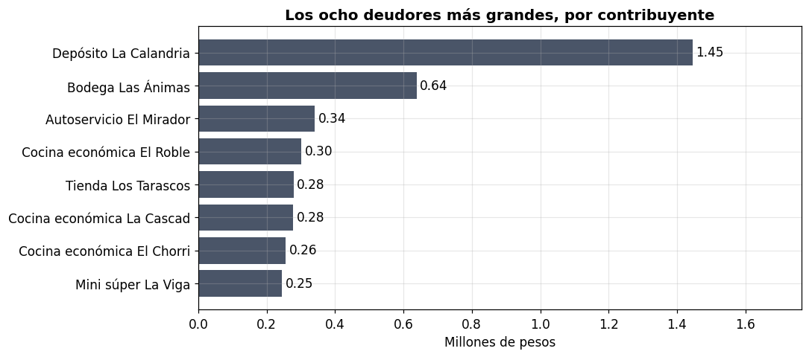
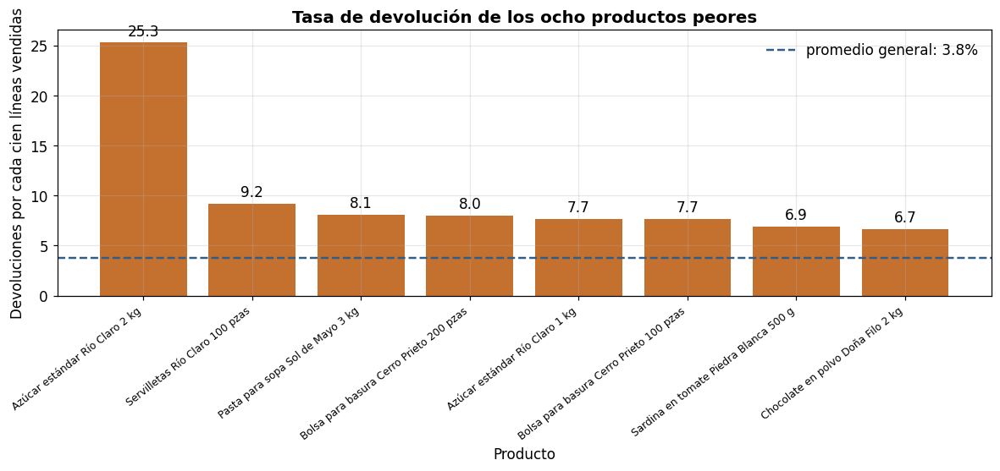
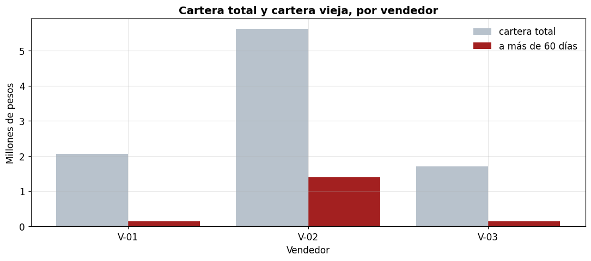
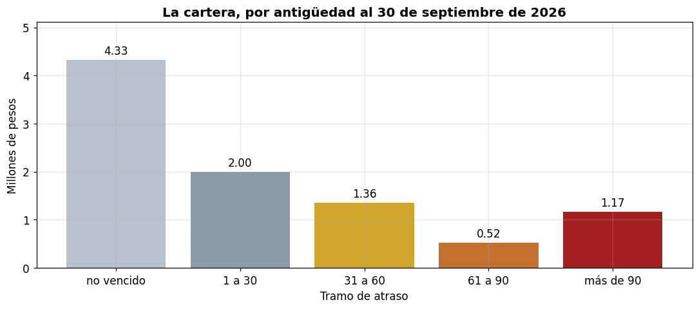

# Dónde se está deteniendo el dinero

**Informe de hallazgos**

| | |
| --- | --- |
| **Cliente** | Distribuidora Camaleón Blanco, S.A. de C.V. — Zapopan, Jalisco |
| **Periodo analizado** | 1 de octubre de 2025 al 30 de septiembre de 2026 |
| **Corte de cartera** | 30 de septiembre de 2026 |
| **Preparado por** | Gato 8 Analítica de Datos · Adan Anaya |
| **Fecha** | 18 de octubre de 2026 |
| **Anexo reproducible** | el cuaderno `demo_efectivo.ipynb`, donde cada cifra de este informe traza a una celda |

> **Los datos de este informe son inventados.** La empresa, sus clientes, sus productos y todas las cifras son sintéticos: prueban el método, no son trabajo hecho para un cliente. Cada número sale del cuaderno público que acompaña a este documento, y se puede volver a generar.

## 1. Resumen para decidir

La pregunta era dónde se está deteniendo el dinero. Con los archivos entregados, la respuesta se concentra en tres lugares y en tres decisiones.

**1. La cartera que ya se pasó de los 90 días.** Hay **MXN 1,172,555.42** con más de 90 días de atraso, el **12.5 %** de la cartera abierta de MXN 9,387,302.00. Es el dinero más viejo y el que más rápido se pierde. Y es un piso, no un techo: la ventana de facturas solo permite ver 182 días de antigüedad, así que la deuda más vieja no está en los archivos. **Decisión que habilita:** cobrar o negociar esos saldos este mes, empezando por los tres deudores que concentran el 25.8 % de la cartera.

**2. La cobranza vieja de un vendedor.** **MXN 1,399,247.14** de su cartera lleva más de 60 días: el **24.9 %** de lo que tiene, contra 7.2 % y 8.7 % de los otros dos. Los plazos autorizados son casi iguales entre los tres, así que no es una diferencia de condiciones. **Decisión que habilita:** revisar su cartera antes que la de los otros. Lo que este dato no dice es si la causa es él o los clientes que le tocaron: la asignación no fue al azar.

**3. Cuatro productos que se venden por debajo de su costo.** Dejan **MXN 117,769.79** de pérdida directa en el año. Si tuvieran el margen promedio del negocio, habrían dejado **MXN 266,913.71** más. **Decisión que habilita:** revisar el precio de esos cuatro, uno por uno.

Dos hallazgos más, que no son dinero inmediato pero cambian el tamaño del problema: **las devoluciones** (MXN 1,450,604.47, con un solo producto al 25.3 % cuando el promedio es 3.8 %) y **la concentración** (los tres mayores deudores, MXN 2,424,162.96, el 25.8 % de la cartera; el mayor, con sus dos cuentas juntas, MXN 1,445,628.04).

**Lo que este informe no puede decir.** Cuánto de esa cartera vieja se acaba cobrando —no hay historia suficiente—. Cuánto capital hay detenido hoy en inventario —el corte es de hace 92 días—. Y si la empresa gana o pierde —no hay sueldos, renta ni fletes en los archivos—. El detalle está en la sección 6.

## 2. Qué se preguntó y qué se recibió

Se pidieron seis archivos. Llegaron nueve, más una carta del dueño explicando lo que no pudo conseguir.

| Lo que se pidió | Lo que llegó | Estado |
| --- | --- | --- |
| Ventas o transacciones | `ventas_12_meses.csv` — 12 meses | Completo, sin la columna de costo ni la de almacén |
| Catálogo de productos | `productos.csv` — 120 productos | Completo, con un solo costo sin fecha |
| Catálogo de clientes | `clientes.csv` — 180 clientes | Completo |
| Facturas y cobranza | `facturas.csv` y `pagos.csv` | **Solo seis meses**: de abril a septiembre de 2026 |
| Egresos o compras | `compras_egresos.csv` | Completo, sin sueldos ni renta |
| Inventario | `inventario.csv` | **Un solo corte, de hace 92 días** |

Dos huecos se anotaron desde el principio: no vino la **columna de almacén**, así que no se puede separar por bodega; ni el **costo por fecha**, así que el margen usa el costo de hoy para los doce meses.

## 3. Cómo están los datos

Antes de calcular nada se hizo el cuadre: la suma del archivo contra el total que el dueño reconoce en su reporte mensual. **Cierra al centavo en los doce meses**, pero solo después de explicar cada peso de la diferencia.

| Concepto | MXN |
| --- | ---: |
| Total tal como viene en el archivo | 41,239,939.17 |
| Menos filas repetidas | −3,387,556.19 |
| Más el IVA que faltaba en tres lotes | 1,429,268.70 |
| **Venta bruta homologada** | **39,281,651.68** |
| Menos notas de crédito | −1,450,604.47 |
| **Venta neta calculada** | **37,831,047.21** |
| Venta neta del reporte del dueño | 37,831,047.21 |
| **Diferencia** | **0.00** |

**Los ocho defectos encontrados**, cada uno con su efecto medido:

| # | Defecto | Evidencia | Efecto |
| --- | --- | --- | --- |
| 1 | Fechas como texto, en dos formatos | 2,329 líneas · 168 imposibles de leer · 92 en otro mes | MXN 288,398.92 en un solo mes · 9 meses afectados |
| 2 | Facturas reexportadas | 120 filas en 30 folios | MXN 660,993.04 contados dos veces |
| 3 | Un mes cargado dos veces | 399 filas de junio | MXN 2,726,563.15 contados dos veces |
| 4 | Precios con y sin IVA | 1,210 líneas en tres lotes | MXN 1,429,268.70 de venta que el archivo no mostraba |
| 5 | Un negocio con dos cuentas | 2 códigos, el mismo RFC | La concentración pasa de 13.3 % a 16.8 % |
| 6 | Un producto renombrado | Un código con dos nombres | El 40.4 % de su volumen parece producto nuevo |
| 7 | Un pago en la factura equivocada | Un pago anterior a su factura, por MXN 109,616.88 | MXN 109,616.88 salen del tramo de más de 90 días |
| 8 | Devoluciones sin restar | 181 notas | MXN 1,450,604.47 de venta que no era venta |

## 4. Los cinco hallazgos, por dinero en juego

Los montos **no se suman entre sí**: tres de los cinco miran la misma cartera desde ángulos distintos. Sumarlos daría un número grande y falso.

### 4.1 Tres clientes concentran la cartera — MXN 2,424,162.96

Los tres mayores deudores, consolidados por contribuyente, deben el **25.8 %** de la cartera abierta. Los ocho primeros, el **40.3 %**. El mayor es un negocio con dos cuentas en el sistema —mismo RFC—: por separado muestra MXN 2,141,510.65 y MXN 363,865.17; junto, **MXN 1,445,628.04**, el **15.4 %** de todo lo que se debe.

### 4.2 Las devoluciones se concentran en un producto — MXN 1,450,604.47

La tasa general de devolución es **3.8 %** de las líneas vendidas. Un producto está en **25.3 %**: 23 devoluciones sobre 91 líneas, por MXN 71,495.49. No es el monto más alto del informe; es la tasa más anómala, y por eso aparece.

### 4.3 Un vendedor carga con la cobranza vieja — MXN 1,399,247.14

Su cartera es además la más grande (MXN 5,622,265.55 de 9,387,302.00). El **24.9 %** de ella lleva más de 60 días. Los otros dos están en 7.2 % y 8.7 %. Los plazos promedio autorizados son 43.5, 42.5 y 37.1 días: casi iguales. La diferencia está en la mezcla de clientes —55.2 % de mayoreo contra 41.9 % y 37.3 %— y, probablemente, en algo que estos datos no registran.

### 4.4 La cartera pasada de 90 días — MXN 1,172,555.42

Es el monto que ya debería estar en el banco. La distribución completa:

### 4.5 Cuatro productos por debajo de su costo — MXN 117,769.79

| Producto | Margen |
| --- | ---: |
| Servilletas Río Claro 500 pzas | −14.7 % |
| Azúcar estándar Río Claro 5 kg | −8.2 % |
| Pasta para sopa Sol de Mayo 500 g | −6.3 % |
| Galletas Marías Río Claro 170 g | −5.5 % |

Con el margen promedio del negocio —**11.4 %**— esos cuatro habrían dejado MXN 266,913.71 más. La diferencia entre las dos cifras importa: la primera es dinero que ya salió; la segunda, dinero que nunca entró.

## 5. Supuestos

Siete supuestos, todos declarados. Cinco se pudieron medir; dos no.

| Supuesto | Si es falso |
| --- | --- |
| El reporte del dueño es el total correcto | El cuadre y todo lo que cuelga de él están mal. No medible con estos datos |
| Un solo costo, el de hoy, para los doce meses | ±5 % en el costo mueve el margen **4.4 puntos**. Con un margen de 11.4 %, eso es un tercio del margen |
| Toda la venta al 16 % de IVA | Si parte del catálogo es de tasa 0 %, la base sin IVA sube y el margen pasaría de 11.4 % a **19.0 %** |
| Las devoluciones se cargan al mes en que regresan | El mismo dinero se reparte entre meses distintos. **88 de 181 notas** cambian de mes; hasta MXN 94,286.30 en uno solo |
| La fecha de una línea es la de su factura | Se usó para resolver **849 fechas ambiguas**, el 17.4 % de la venta: MXN 6,828,643.61 |
| La ventana de doce meses es la que importa | La estacionalidad cambia de forma. No medible con estos datos |
| El pago mal aplicado se reasignó al saldo que coincide | El tramo de antigüedad de esa cartera se mueve. Son MXN 109,616.88 |

La tasa de IVA no se supuso: se comprobó contra las notas de crédito, que traen el mismo importe en las dos bases, y da **1.1600**.

## 6. Límites de este análisis

1. **La ventana de facturas recorta la cartera.** Solo hay seis meses. La factura más vieja es del 1 de abril y el corte es del 30 de septiembre: 182 días. El monto de más de 90 días es un piso.
2. **No hay inventario actual.** El corte es del 30 de junio, 92 días antes del cierre, y es el único. No se puede decir cuánto capital hay detenido hoy.
3. **No hay costos operativos.** Solo compras de mercancía. El margen bruto no es utilidad y no debe leerse así.
4. **No hay columna de almacén.** El margen no se puede ubicar en una de las dos bodegas.
5. **El motivo de devolución es una etiqueta de cinco opciones.** Se sabe dónde se devuelve, no por qué.
6. **Un solo costo, sin fecha.** El margen es un promedio del año, no una tendencia.
7. **No hay pedidos no surtidos.** No se puede separar la caída de ventas entre demanda y abasto.
8. **Una sola ventana de doce meses.** La estacionalidad se ve una vez y sin comparación.

**Ninguna afirmación de causalidad.** La diferencia entre vendedores es un hecho del dato; decir que el vendedor la causa no está sostenido por este diseño. Para afirmarlo haría falta comparar clientes parecidos asignados al azar, o un corte donde el mismo vendedor cambie de cartera.

## 7. Cómo se comprobará si funcionó

| # | Indicador | Hoy | Cuándo se revisa |
| --- | --- | ---: | --- |
| 1 | Parte de la cartera en los tres mayores | 25.8 % | Al cierre de cada trimestre |
| 2 | Tasa de devolución del producto | 25.3 % | Cada mes, tres meses |
| 3 | Parte de la cartera del vendedor con más de 60 días | 24.9 % | Cada mes |
| 4 | Parte de la cartera con más de 90 días | 12.5 % | Cada mes |
| 5 | Margen de los cuatro productos | −14.7 % el peor | Un mes después de cambiar el precio |

**Se mide en proporción, no en pesos.** La ventana de facturas crece cada mes, así que el monto de la cartera vieja sube solo: hoy solo la mitad de la ventana puede aportar deuda de más de 90 días, y en tres meses serán dos terceras partes. Comparar montos entre cortes sería comparar dos cosas distintas.

Cada indicador tiene una trampa posible, y está anotada en el cuaderno: si la cartera total baja, el porcentaje de concentración sube sin que el riesgo suba; un lote dañado mueve la tasa de un producto sin que el problema sea el producto; si el costo se mueve, el margen cambia aunque el precio no.

## 8. Anexos reproducibles

Todo este informe sale de un solo cuaderno: `demo_efectivo.ipynb`. Está ejecutado, con sus salidas y sus gráficas, y se lee en el navegador sin instalar nada.

Cada cifra traza a una celda anterior del cuaderno, los datos se reconstruyen con un comando y una semilla fija, y el cuaderno incluye el registro de defectos, los supuestos con su sensibilidad, los límites y la tabla de medición.

## Alcance y limitaciones

Este trabajo es analítica de datos aplicada a decisiones comerciales y de finanzas corporativas. No constituye asesoría fiscal, contable, legal ni de inversión, ni un dictamen o auditoría. Las cifras se derivan de la información proporcionada por el cliente y de los supuestos declarados en este documento; su exactitud depende de la calidad de esa información. Los resultados no están garantizados: dependen de los datos de origen y de las decisiones que el cliente tome. Este entregable es un insumo para decidir, no una recomendación de inversión ni una opinión fiscal.

---

*Gato 8 Analítica de Datos · Adan Anaya · aanaya8@proton.me*
